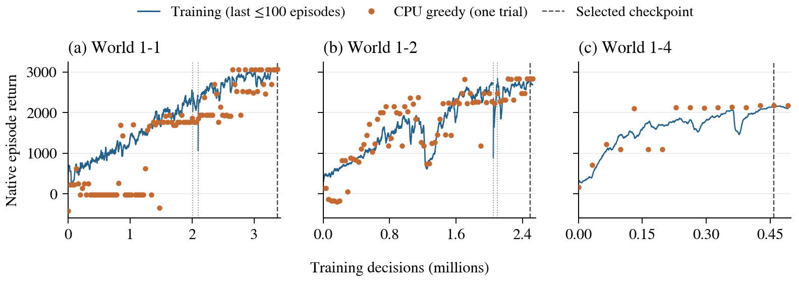
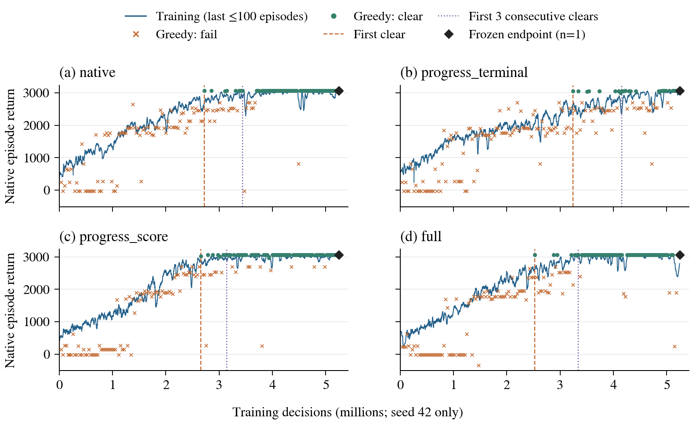

# Mario RL on Apple Silicon

Four independently trained visual agents play World 1 of Super Mario Bros. The 1-1, 1-2, and 1-4 agents use PPO; 1-3 uses behavior cloning from a trajectory found by the project's own prefix search. All four models start from random initialization. Each cleared its level in five CPU greedy evaluations from the standard starting point.

The environment runs on CPU and PyTorch can train the network on Apple Silicon using MPS. See [Training and experiments](docs/training.md) for the PPO recipe, reward comparison, and 1-3 method.

## Quick start

Use macOS on Apple Silicon with Python 3.11. Clone the repository, install the environment, and run the four trained agents:

```bash
git clone https://github.com/Staudinger0325/mario-rl-apple-silicon.git
cd mario-rl-apple-silicon
MARIO_PYTHON=python3.11 ./setup.sh
.venv/bin/python scripts/play_world1.py
```

`setup.sh` creates `.venv`, installs the pinned dependencies, and checks the device and game environment. The pinned `gym-super-mario-bros==7.4.0` distribution includes the game assets used by this environment, so the standard setup requires no manual ROM-copying step.

The player opens a window and runs levels 1-1 through 1-4, loading each level's model from `weights/` for CPU inference. No training is required. To run all four levels without a window:

```bash
.venv/bin/python scripts/play_world1.py --headless
```

To repeat the environment check or test a window:

```bash
.venv/bin/python -m mario_rl doctor
.venv/bin/python -m mario_rl doctor --window
```

## Play and evaluate

The published models and manifest are in `weights/`. The general CLI defaults to the local model for the selected World 1 level and does not download weights. Verify the files, then play all four levels or a selected level:

```bash
.venv/bin/python scripts/play_world1.py --manifest weights/manifest.json --verify
.venv/bin/python scripts/play_world1.py --manifest weights/manifest.json
.venv/bin/python scripts/play_world1.py --manifest weights/manifest.json --level 1-3
.venv/bin/python scripts/play_world1.py --manifest weights/manifest.json --level all --headless
```

The interactive demonstration supports P to pause, R to restart the current level, and Escape to exit. `--headless` runs one episode per selected level. For a five-episode evaluation of a specific checkpoint, use the matching world and stage:

```bash
.venv/bin/python -m mario_rl evaluate --checkpoint weights/world1-1-ppo.pt \
  --world 1 --stage 1 --device cpu --episodes 5 --max-steps 3000 \
  --output outputs/eval-1-1
```

Add `--record` to save the first episode as an MP4. Evaluation uses greedy action selection. The reported five runs use seeds 0–4, a 3,000-decision limit, and require the clear flag and a genuine termination. They all use the same known map and starting point, so they measure stability in that setting rather than generalization to new maps.

| Level | Method | Clears | Decisions per episode | Raw return |
|---|---|---:|---:|---:|
| 1-1 | PPO | 5/5 | 283 | 3,065 |
| 1-2 | PPO | 5/5 | 285 | 2,835 |
| 1-3 | Own search + behavior cloning | 5/5 | 439 | 2,298 |
| 1-4 | PPO | 5/5 | 189 | 2,181 |

## Learning curves and data





The underlying [World 1 evaluation results](results/world1-evaluation.csv), [reward comparison](results/ablation-seed42.csv), and [learning curves](results/learning-curves/) are available as CSV files.

The released checkpoints contain model tensors with SHA-verified manifest entries; they do not include optimizer state. Training from scratch creates a new experiment and does not guarantee identical learning curves.

## Repository layout

- `mario_rl/`: environment, observation processing, model, PPO training, and evaluation.
- `scripts/`: World 1 player, prefix exploration, behavior cloning, and validation tools.
- `weights/`: four trained checkpoints and their manifest.
- `results/`: evaluation and learning-curve data.
- `tests/`: automated tests.
- `third_party/`: retained third-party license material.

The model design references [Viet Nguyen's Super Mario Bros PPO implementation](https://github.com/vietnh1009/Super-mario-bros-PPO-pytorch); its MIT license is retained in `third_party/`. The World 1 models supplied here were trained from scratch rather than initialized from those upstream weights.

## Tests

```bash
.venv/bin/python -m unittest discover -s tests -v
```
